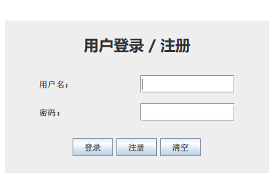
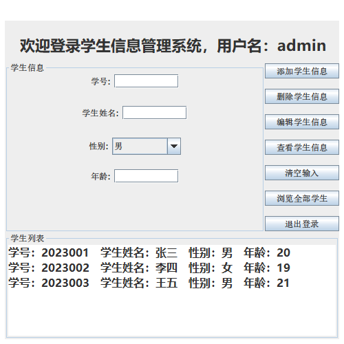

# Java 学生信息管理系统

基于 Java Swing 开发的桌面应用，实现用户登录注册与学生信息的增删改查。本项目为 Java 课程设计作品。

## 功能说明

### 用户模块
- 注册：用户名、密码非空校验，用户名重复校验
- 登录：用户名与密码校验，支持退出登录

### 学生模块
- 添加：填写学号、姓名、性别、年龄，学号重复校验
- 删除：按学号删除
- 修改：按学号定位后整条更新
- 查询：按学号查询，弹窗展示详情
- 浏览全部：独立窗口表格展示，与主界面数据实时同步
- 清空输入：一键清空当前表单

## 项目截图






## 技术栈

| 项目 | 说明 |
| --- | --- |
| 语言 | Java（JDK 8 及以上） |
| 界面 | Swing（JFrame、JPanel、JTable、JComboBox 等） |
| 布局 | BorderLayout、GridLayout、FlowLayout |
| 数据结构 | `HashMap` 存储用户，`ArrayList` 存储学生 |
| 交互 | 事件监听（ActionListener） |

## 项目结构

```
students-manage-system/
├── src/
│   └── Main.java          # 入口类，包含 User、Student、Main 三个类
├── screenshots/           # 项目运行截图
├── .gitignore
└── README.md
```

- `User`：用户实体，封装用户名与密码，提供密码校验方法
- `Student`：学生实体，封装学号、姓名、性别、年龄
- `Main`：程序入口与全部界面逻辑（登录注册页、主界面、学生列表页）

## 运行方式

### 使用 IntelliJ IDEA
1. 打开项目目录
2. 确认 Project SDK 为 JDK 8 及以上
3. 运行 `src/Main.java` 中的 `main` 方法

### 使用命令行
```bash
cd src
javac -encoding UTF-8 Main.java
java Main
```

程序启动后进入登录页面，首次使用需先注册账号。
