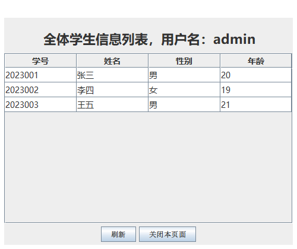

# Java 学生信息管理系统

基于 Java Swing 开发的桌面学生信息管理系统，包含用户登录注册与学生信息的增删改查功能。本项目为 Java 课程设计作品。

## 功能说明

### 用户模块
- 注册：用户名、密码非空校验，用户名重复校验
- 登录：用户名存在性校验、密码校验
- 登录成功后可退出登录，返回登录页面

### 学生模块
- 添加学生：学号、姓名、性别、年龄，学号重复校验
- 删除学生：按学号删除
- 修改学生：按学号定位后整条更新
- 查询学生：按学号查询，弹窗展示详细信息
- 浏览全部学生：独立窗口，表格展示，与主界面数据实时同步
- 清空输入：一键清空当前表单

## 项目截图

### 登录注册


### 主界面


### 学生列表



## 技术栈

| 项目 | 说明 |
| --- | --- |
| 语言 | Java（JDK 8 及以上） |
| 界面 | Swing（JFrame、JPanel、JTable、JComboBox 等） |
| 布局 | BorderLayout、GridLayout、FlowLayout |
| 数据结构 | `HashMap` 存储用户，`ArrayList` 存储学生 |
| 交互 | 事件监听（ActionListener） |

## 项目结构

```
students-manage-system/
├── src/
│   └── Main.java          # 入口类，包含 User、Student、Main 三个类
├── screenshots/           # 项目运行截图
├── .gitignore
└── README.md
```

`Main.java` 中的三个类职责如下：

- `User`：用户实体，封装用户名与密码，提供密码校验方法
- `Student`：学生实体，封装学号、姓名、性别、年龄
- `Main`：程序入口与全部界面逻辑（登录注册页、主界面、学生列表页）

## 运行方式

### 使用 IntelliJ IDEA
1. 打开项目目录
2. 确认 Project SDK 为 JDK 8 及以上
3. 运行 `src/Main.java` 中的 `main` 方法

### 使用命令行
```bash
cd src
javac -encoding UTF-8 Main.java
java Main
```

程序启动后进入登录页面，首次使用需先注册账号。

## 设计说明

- 用户数据使用 `HashMap<String, User>` 存储，以用户名为 key，便于登录时直接定位
- 学生数据使用 `ArrayList<Student>` 存储，便于顺序遍历与表格展示
- 学生列表页与主界面共用同一个 `DefaultTableModel`，任一界面修改数据后调用 `refreshTable()` 刷新，保证两个窗口显示一致
- 表格重写了 `isCellEditable` 返回 `false`，禁止在表格中直接编辑，所有修改必须经过表单校验

## 已知不足

- 数据仅保存在内存中，程序关闭后用户与学生数据全部丢失，未做持久化
- 密码为明文存储，未做加密处理
- 界面逻辑与业务逻辑仅做到方法级拆分，未抽象出独立的 Service 层
- 学号唯一性依赖每次添加时遍历 List 校验，数据量增大后效率会下降
